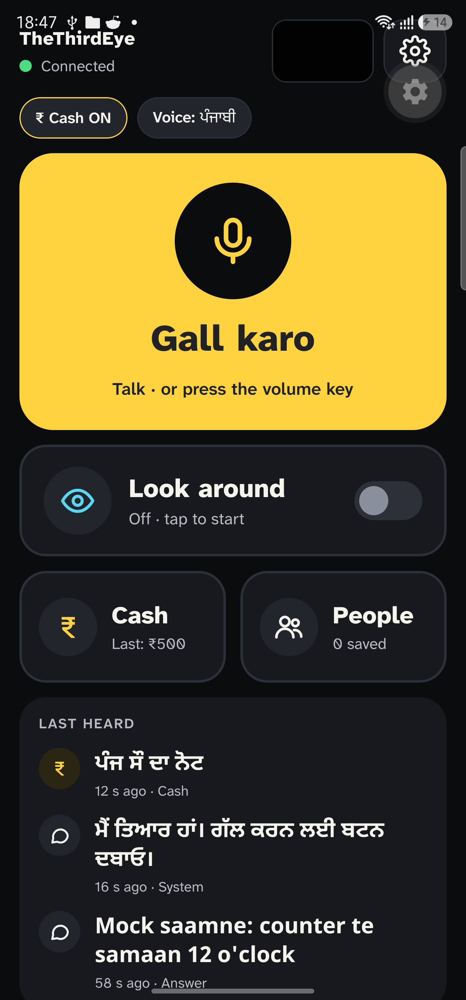
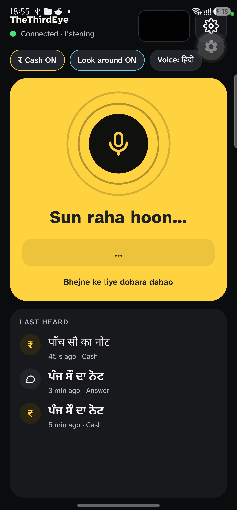
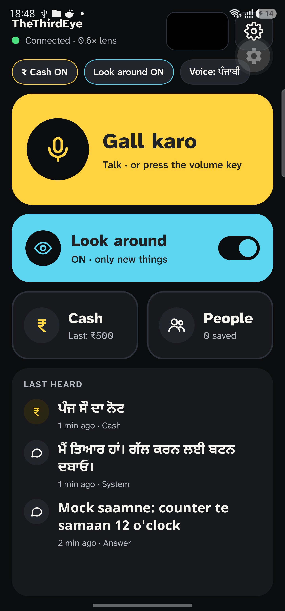
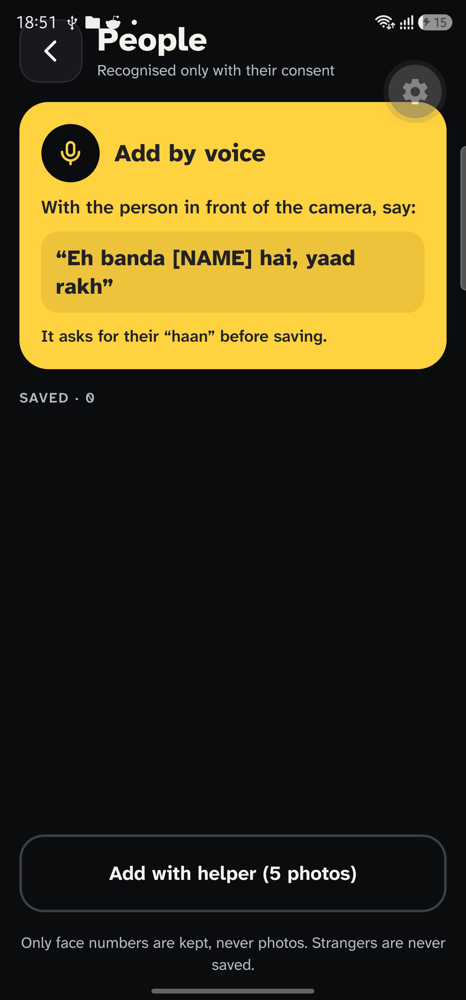
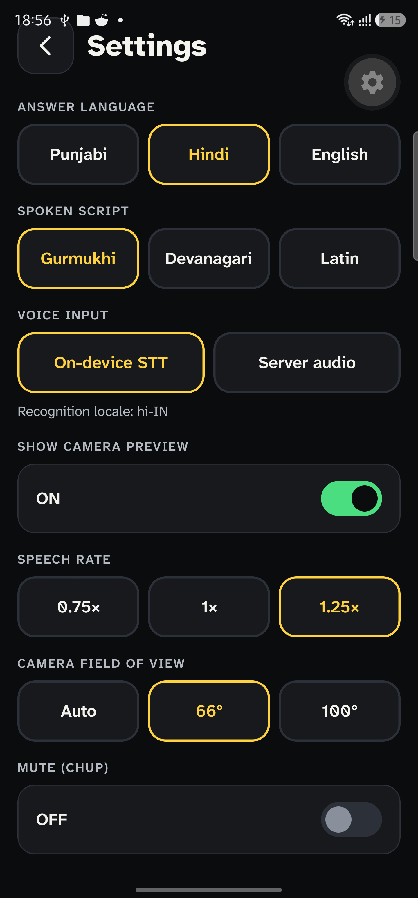
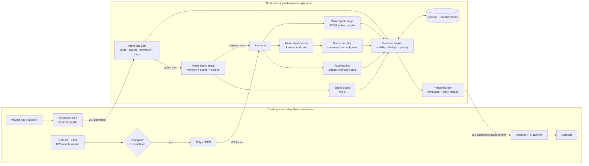

# TheThirdEye

**A proactive, hands-free second pair of eyes for blind and ultra-low-vision people, built on Meta's Muse models and designed for Meta glasses.**

TheThirdEye watches the world in front of you and speaks only when something matters: the value of a note held out to you, who just walked in, what a label says, where you left the scissors. A few calm words in your ear, in your own language. The rest of the time, it stays silent.

> **Reactive assistants answer questions. TheThirdEye notices for you.**

> **Honesty statement (shown in-app on first launch).**
> TheThirdEye is an assistive aid, not a medical or safety device. It reads
> currency denominations and describes surroundings using AI, and it can be
> wrong. It does not detect counterfeit or damaged notes. Important amounts
> should be confirmed by another person. Face recognition works only for
> people who have agreed to be enrolled. TheThirdEye supports the user's own
> judgment and mobility aids; it does not replace them.

---

## At a glance

| | |
|---|---|
| **Who it's for** | Blind and ultra-low-vision people, especially those who work with their hands |
| **Where it's going** | Meta glasses: camera at eye level, open-ear audio, nothing to hold |
| **What runs today** | Android phone in a chest mount + Bluetooth earbuds, standing in for the glasses |
| **What it does** | Reads cash, recognises consented people, describes, reads and finds things on request |
| **How it speaks** | Short Punjabi + English phrases, Hindi understood. Says "pakka nahi" (not sure) instead of guessing |
| **Meta models** | `muse-spark-1.3` via the Meta Model API for triage, scene, conversation and find |
| **Try it without a key** | `PROVIDER=mock` runs the full loop with scripted vision |

---

## Why this exists

This project started with one person. A friend of mine runs a small kirana shop. He was born with one weak eye, and a brain tumour pressing on the optic nerve took almost all the sight from the other. He still opens the shop every day and serves customers himself, usually with no free hand.

Watching his day made the problem concrete. Sight matters in dozens of small moments, and each one arrives when his hands are busy:

- **Someone hands him a note.** He can tell a lot by touch, but touch alone doesn't always give him the denomination quickly, especially in a rush.
- **Someone walks in.** He hears the door or footsteps, but not whether it's his brother, a supplier, a regular or a stranger, or where they are standing.
- **He needs to check something.** A label, what's on the counter, where he put something down. Today that means asking someone, or picking up a phone, unlocking it, opening an app, pointing it and waiting.

His situation is not unusual. Millions of people live with blindness or near-total vision loss, and many of them work, cook, shop, run errands and look after families with their hands full. The shop is simply where we first saw the problem clearly, and it is the first real environment TheThirdEye is built and tuned for. It is **not** a shopkeeper app. It is an assistant for anyone who has lost most or all of their sight and needs information about the world in front of them without stopping what they are doing.

### What existing tools miss

Gemini Live, Meta AI and Be My Eyes are impressive, but they are general and **reactive**: you have to stop, hold a phone, point it and ask. The assistant then forgets the context when the conversation ends. That works for a curious question at home. It doesn't work with a customer waiting, a child holding your hand, or a pot on the stove.

| | General assistants | TheThirdEye |
|---|---|---|
| Who starts the conversation | The user, every time | The system, when something relevant happens |
| Hands | Hold a phone, tap to ask | Hands-free: glasses (target), chest camera (today) |
| Context | Forgets between questions | Knows your people, your space, and what just happened |
| Default behaviour | Talks at length when asked | Silent; a few words when it matters |
| Language & money | Generic | INR denominations, Punjabi + English mix |

---

## Built for Meta glasses

**TheThirdEye is designed for smart glasses, and Meta glasses are its intended home.** A blind person shouldn't have to hold, mount or aim anything. Glasses put the camera where the eyes are, so it always faces what the wearer faces. Open-ear speakers deliver a few words without blocking the sounds of the room. Both hands stay free. For a person who relies on hearing and touch all day, that form factor isn't a convenience; it's what makes the product usable at all.

### Why a phone for this hackathon

We could not get Meta glasses in time for this build. Rather than wait, we built **mobile-first**, with every part of the system shaped around the glasses it will eventually run on:

- A **Samsung S23 Ultra in a chest mount** stands in for the glasses camera, capturing first-person frames at ~2 fps.
- **Bluetooth earbuds** in ambient mode stand in for open-ear audio.
- A **volume-key push-to-talk** stands in for the glasses mic and, later, a wake word.

The phone setup also showed us why glasses matter. A phone hanging at the chest and a pair of earbuds is extra equipment to put on, adjust and keep pointed in the right direction, which is exactly the kind of friction a blind user shouldn't carry. Glasses remove it.

### What changes on glasses, and what doesn't

The architecture splits into a **thin client** (capture, gate, mic, speech) and a **smart server** (perception, memory, decisions, wording). Glasses replace only the client.

| Component | Today (phone) | On Meta glasses |
|---|---|---|
| Camera | S23 back camera, chest mount | Glasses camera, eye level |
| Change gate | On the phone | On the paired phone / companion app |
| Input | Volume key or Talk tile, Android STT | Glasses mic, wake word |
| Output | Android TTS → earbuds | Open-ear glasses speakers |
| Perception, memory, decisions | Node server | **Unchanged** |

Every frame the server sees today is the kind of frame glasses would send: first-person, hands-free, a couple per second. The perception, decision and speech pipeline you can run now *is* the glasses pipeline. Moving to Meta glasses is the first item on our roadmap after the hackathon.

---

## What it does today

Three features, working end to end over one WebSocket.

### Cash: the note held out to you (F1)

A note held out is announced without asking, once per note: *"Panj sau da note."* If the camera can't read it clearly, it says *"Pakka nahi, note sidha karo"* (not sure, straighten the note) instead of guessing. *"Eh kinne da?"* (how much is this?) forces a fresh read. It reports the denomination only: no totals, no change calculation, no counterfeit check.

### Awareness: who's here (F2)

When someone arrives, one short line. People who have consented to be enrolled are named: *"Ravi aa gaya"* (Ravi's here). Everyone else is described generically: *"Ik banda, around 30, counter te"* (a man, around 30, at the counter). *"Kaun hai?"* (who's there?) gives a summary of the people in front of you. People leaving are never announced.

### On demand: describe, read, find (F3)

Press to talk and ask in your own words:

- *"Ki hai saamne?"* (what's in front?) → a description in 15 words or fewer
- *"Eh padh"* (read this) → the key text first (name, price, expiry), then *"hor?"* (more?) only if there's more
- *"Kainchi kithe hai?"* (where are the scissors?) → *"right side, neeche"* (right side, low down) or *"Nahi labhi"* (couldn't find it)

A **look-around** mode switches to the ultra-wide camera and narrates the scene once, then mentions only what's new, with clock-position cues.

### When it speaks, and when it doesn't

Silence is enforced in code, not left to the model. A decision engine turns perception into events and applies three rules:

- **Stability.** A note is announced only after two agreeing frames or one high-confidence read. A name only after a match in two of three frames.
- **De-duplication.** The same note isn't repeated while it stays in view. The same person isn't re-announced for 10 minutes (enrolled) or 2 minutes (unknown).
- **Priority.** Cash and answers to your questions (P1) interrupt everything else. Arrivals (P2/P3) wait their turn and are dropped if they go stale. **A stale message is worse than no message.**

Say *"chup"* (quiet) and only cash and your own questions will speak until you say *"bol"* (speak).

---

## Screens

| Home (idle) | Listening | Look-around |
|---|---|---|
|  |  |  |

| People | Settings |
|---|---|
|  |  |

---

## Principles

1. **Silence is a feature.** The default state is quiet, and every sentence must earn its place. A missed low-value event is fine; constant chatter is not.
2. **Short and calm.** Two to six words where possible. The answer first, details only if asked. No filler.
3. **Proactive, not reactive.** It notices and tells you without being asked, and answers instantly when you do ask.
4. **Hands-free, always.** Nothing in the core loop requires touching a phone. That is why glasses are the destination.
5. **Your world, not a generic one.** Your people, your space, your moment, in your mix of languages, with amounts said the way you say them.
6. **Never overclaim.** It says what it sees, and "not sure" when it isn't. A wrong confident answer is worse than *"dobara dikhao"* (show it again).
7. **Privacy by default.** Only opted-in people are recognised. Everyone else is described generically and never identified, stored or tracked. Frames are processed and discarded; no video is recorded.
8. **Support, don't replace.** The user's experience, touch, cane and the people around them stay the final authority.

## What we will NOT do

- Claim to detect **counterfeit or damaged** notes. Denomination only.
- Guarantee cash readings. The app carries a clear disclaimer.
- **Identify strangers.** No face search, no profiles of the people around you.
- Record or store video.
- Guide through traffic or say when it's "safe to cross". Mobility is out of scope; any future mobility feature will give awareness cues only, never permission.
- Do bill maths or run the till. The user calculates; we say what's in their hand.
- Make the user talk to it all day. If they have to keep asking, we built the wrong product.

---

## How it works



1. **Capture and gate (client).** The camera runs at about 2 fps with the preview off. A 32×32 grayscale diff against the last sent frame decides whether anything changed; only changed frames (plus a periodic heartbeat) go up as 768 px JPEGs. A still scene costs nothing and says nothing.
2. **Perceive (server).** Muse Spark triages each gated frame into structured JSON (notes and people) in a single call. A local face sidecar matches enrolled people. In look-around, a separate scene call feeds the narrator.
3. **Understand (server).** Spoken commands hit a fast path first (mute, cancel, how much, more). Anything else goes to a Muse Spark agent with session memory, the current scene, and actions such as capturing a fresh frame or locating an object.
4. **Decide (server).** The decision engine applies stability, de-duplication and priority, and stays silent unless an event earns speech.
5. **Speak (client).** The phrase builder fills short templates for proactive events (fast and consistent) and uses free-form model text only for describe and read answers. `speak` messages carry text, language, priority and a kind; the phone speaks them with on-device TTS.

One WebSocket carries frames, audio and commands up and `speak` messages down. The API key lives only on the server.

## Models (exact)

| Job | Model | Notes |
|---|---|---|
| Cash/people/scene triage, conversation, find | `muse-spark-1.3` (Meta Model API) | Reasoning model: `reasoning_effort: "minimal"`, JSON mode with prompt-only fallback |
| Face detection + embedding | YuNet + ArcFace via `deepface==0.0.103` | Local Python sidecar (`apps/faces`), ArcFace 512-d, threshold 0.45 + 0.08 margin |
| Speech recognition | Android STT | `expo-speech-recognition`, `pa-IN` with `hi-IN`/`en-IN` fallback (the S23 test phone has no `pa-IN`); server-audio mode is a fallback, not Meta STT |
| Speech output | Android TTS (`expo-speech`) | `pa-IN` / `hi-IN` / `en-IN`; Meta has no TTS model, so this is the honest choice |

"Find X" uses Spark's locate call, not SAM 3.1 (a stretch goal we skipped).

---

## Quickstart

Prereqs: Node 20+, Python 3.12 + `uv`, Android Studio (SDK + a JDK).

```bash
git clone <repo> && cd thethirdeye
npm install

# 1. Server (mock vision, no key needed)
cd apps/server && cp .env.example .env
npm start            # ws://<laptop>:8080, PROVIDER=mock

# 2. Face sidecar (real recognition; optional, server falls back to stub)
cd ../faces
./run.sh             # Windows: ./run.ps1  ->  http://127.0.0.1:8765

# 3. Phone (Expo dev build, Samsung S23 Ultra over wifi ADB)
cd ../mobile
npx expo run:android # or: cd android && ./gradlew assembleDebug
```

Point the app at the laptop: the default URL is the Windows hotspot gateway (`ws://192.168.137.1:8080`), and you can change it in Settings without rebuilding. The first launch shows the honesty statement (English + Punjabi) and speaks a summary before the camera starts.

Tests: `npm test` at the root (node:test suites, never touch the network) and `npm run typecheck`. Live vision eval (needs `META_API_KEY`): `cd apps/eval && npm run spike -- notes --provider meta`.

## Provider setup

Copy `apps/server/.env.example` to `apps/server/.env`:

| Variable | Meaning |
|---|---|
| `PROVIDER` | `mock` (default) \| `meta` \| `openrouter` \| `openai` \| `local` |
| `META_API_KEY` / `META_BASE_URL` / `META_MODEL` | Meta Model API (`muse-spark-1.3`) |
| `OPENROUTER_API_KEY` / `OPENROUTER_MODEL` | OpenRouter-served Muse |
| `OPENAI_API_KEY` / `OPENAI_BASE_URL` / `OPENAI_MODEL` | Plain OpenAI or local Ollama (`PROVIDER=local` defaults to `muse-glimmer`) |
| `AGENT_MODEL` / `AGENT_MAX_TOKENS` / `AGENT_IMAGE_PX` / `AGENT_TOOL_MODE` / `AGENT_REASONING_EFFORT` / `AGENT_DEBUG_DIR` | Conversational agent tuning |
| `TRIAGE_MAX_TOKENS` / `SCENE_MAX_TOKENS` / `META_REASONING_EFFORT` / `FIND_MAX_TOKENS` / `CAPTURE_TIMEOUT_MS` / `TRIAGE_IMAGE_PX` | Perception tuning |
| `APP_TOKEN` | Shared WS token (the phone sends it in `hello`; unset = open server, for local dev only) |
| `FACES` / `FACES_EVERY_N` | `sidecar` (auto if `:8765` answers) or `stub`; detection cadence |
| `UW_CASH_CROP` | Centre-60% crop for the cash prompt on ultra-wide frames (`0` disables) |
| `DEBUG_LOG_IMAGES` | Keep image prefixes in eval debug files (`false` by default: sizes only) |
| `PORT` / `THETHIRDEYE_DB` | HTTP/WS port (default 8080), SQLite path for face embeddings |

`PROVIDER=mock` runs the whole loop with scripted vision, so every demo in this README works with no key.

## Judges' deploy

- **Server:** `render.yaml` at the repo root is a Render Blueprint. It builds `apps/server/Dockerfile` (Node 20 slim, `FACES=stub`), health-checks `/health`, and generates `APP_TOKEN`. Set `PROVIDER=meta` + `META_API_KEY` in the dashboard for live vision. `/data` is ephemeral on the free tier, so enrolled faces reset on redeploy unless a disk is attached there.
- **APK:** bake the judges' endpoint and token in at build time, then build the signed release (see `apps/mobile/android/app/build.gradle` for the signing props in `~/.gradle/gradle.properties`; the keystore itself is never committed):
  ```bash
  cd apps/mobile
  EXPO_PUBLIC_SERVER_URL=wss://<service>.onrender.com \
  EXPO_PUBLIC_APP_TOKEN=<render-app-token> \
    npx expo run:android --variant release
  ```
  Native libs ship 16 KB-page aligned (Expo SDK 58 / AGP 8.x), as Android 15+ requires.

---

## Privacy

- **Frames are processed and discarded.** TheThirdEye never writes a frame or face crop to disk. Every gated frame is sent to Meta's standard (non-training) tier for vision. Debug logs record sizes, never image bytes (`DEBUG_LOG_IMAGES` exists for local diagnosis and defaults to off).
- **Embeddings, not photos.** The SQLite store keeps face embeddings (number vectors), never images.
- **Consent first.** Strangers are never named or persisted. Enrolling a face requires a recorded "haan" (yes); that voice consent is stored with the enrollment, and anyone can be forgotten by voice (*"Ravi nu bhul ja"*, forget Ravi).
- **Locked down on a network.** `APP_TOKEN` closes unauthenticated sockets (4401). The API key lives on the server, never on the phone.

## Limitations (honest)

- **Not yet tested on glasses.** We have no Meta glasses, so everything so far has run on the phone stand-in. The glasses split is an architectural decision, not a tested integration.
- **Cash accuracy.** Live eval (contributor tier): 59/60 runs correct (98.3%) over 30 clear photos × 2 image sizes (5 per denomination), with zero wrong values; the one miss said "unsure". Hard-set photos (folded, angled, dim) are still pending.
- **Latency.** Triage p50 is ~2.7–3.0 s, so the 3.5 s p50 answer budget is tight end to end, and the 2.5 s cash target isn't met yet. Spark is a reasoning model and takes seconds per call; proactive triage p50/p95 is reported live in `/stats` as `triageMs`.
- **Cloud face recognition is off** (`FACES=stub` in Docker/Render). Recognising people by name needs the laptop sidecar running beside the server.
- **Language.** Punjabi-first with Hindi/English fallback, but the S23 test phone has no `pa-IN` speech recognition, so it falls back to `hi-IN`/`en-IN`. The TTS voice choice still needs the user's ear test. Enrollment quality gates assume a cooperative, front-facing subject.

## Roadmap

1. **Move to Meta glasses.** Glasses camera stream in place of the phone camera, glasses mic, open-ear audio, and a wake word in place of push-to-talk. The server side is glasses-ready by design.
2. **Real-world testing with blind and low-vision users,** starting with the friend whose shop inspired this, then widening to other daily settings: home, market, workplace.
3. **Close the latency gap** to the 2.5 s p50 cash budget, and run the hard-set cash eval (folded, angled, dim notes).
4. **On-device triage** for all-day use: a small note classifier plus on-device person detection, with only uncertain frames going to the cloud, to bring standard-tier cost down from ~$9/day.
5. **More currencies and languages,** so the same assistant works beyond INR and Punjabi.

---

*TheThirdEye began with one friend and one shop. It is built for everyone who has lost their sight but not their independence.*
