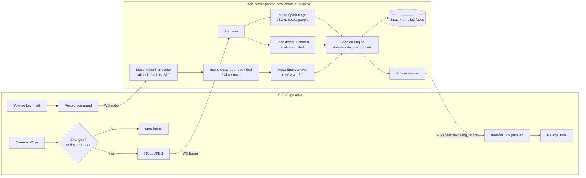

# TheThirdEye — MVP Spec

> Hackathon build: 30 Oct → 2 Nov 2026 (code), 3 Nov (field test + demo shoot), 4 Nov (submit).
> Device for MVP: Samsung S23 Ultra chest-mounted + Galaxy Buds 2 (backup: Realme Buds Wireless 5 ANC).
> Languages: Punjabi + English mix (Hindi understood). Currency: INR ₹10, 20, 50, 100, 200, 500.

---

## 0. Two facts that shape this spec

1. **We build mock-first.** Every model sits behind an adapter. Until a Meta key works, the vision adapter returns fixed answers, so camera, triggers, speech, audio and enrollment are all built and tested without any API.
2. **Muse models are reachable without the broken key.** The Meta Model API is OpenAI-SDK compatible, and Muse Spark and Muse Glimmer are also served on OpenRouter (and Glimmer on Together/Fireworks). One OpenAI-compatible client with a configurable `baseURL` covers all of them. *Ask Discord whether OpenRouter-served Muse models satisfy "uses Meta's models"; the Meta Model API stays the target when the key works.*

---

## 1. MVP scope

Three features. Mobility is out (manifest §4).

### F1 — Cash: denomination of a note held out to him

**User stories**
- When a customer holds a note out to me, I hear its value without asking, so I can keep serving with both hands.
- If the camera can't read it clearly, I'm told to hold it differently rather than given a guess.
- I can ask "eh kinne da?" ("how much is this?") to force a fresh read.

**What he hears**

| Situation | Spoken (Gurmukhi for TTS) | Roman |
|---|---|---|
| Clear note | ਪੰਜ ਸੌ ਦਾ ਨੋਟ | panj sau da note |
| Clear note | ਵੀਹ ਦਾ ਨੋਟ | veeh da note |
| Two notes visible | ਦੋ ਨੋਟ: ਸੌ, ਪੰਜਾਹ | do note: sau, panjah |
| Not sure | ਪੱਕਾ ਨਹੀਂ, ਨੋਟ ਸਿੱਧਾ ਕਰੋ | pakka nahi, note sidha karo |

No totals, no change calculation, no "fake/real" (manifest §4).

**Acceptance criteria**
- ≥ 95% correct on the clear-note test set (§6). On unclear notes it says "not sure" instead of a wrong value ≥ 90% of the time.
- Note held steady → speech starts within **2.5 s p50, 4 s p95**.
- The same note is announced **once**. It's re-announced only if it leaves view for > 3 s and comes back.

### F2 — Shop awareness: who's here (thin slice)

**User stories**
- When someone enters, I hear one short line about them.
- When an enrolled person arrives, I hear their name.
- I can ask "kaun hai?" ("who's there?") for a summary of the people in front of me.

**What he hears**

| Situation | Spoken |
|---|---|
| Enrolled person appears | ਰਵੀ ਆ ਗਿਆ (Ravi aa gaya) |
| Unknown person appears | "Ik banda, around 30, counter te" |
| "kaun hai?" | "Do log: Ravi left side, ik aurat door kol" |

Strangers are never named, stored, or tracked by identity. Only enrolled people get names.

**Acceptance criteria**
- An enrolled person facing the camera within ~2 m is named within 3 s, ≥ 90% of the time, with **zero wrong names** in the test runs. When uncertain, they're described as unknown.
- The same person isn't re-announced within 10 min (enrolled) or 2 min (unknown).
- The rough position (left/centre/right, near/far) is correct ≥ 80% of the time.

### F3 — On-demand: describe, read, find

**User stories**
- I press one button (or later say a wake word) and ask in my own words.
- "Ki hai saamne?" → a short description of what's in front.
- "Eh padh" / "read this" → the label or text read out.
- "Kainchi kithe hai?" ("where are the scissors?") → its direction.

**What he hears**
- Describe: ≤ 15 words. For example: "Counter te do packet, ik phone, left side ik thaila."
- Read: the key text first (product name, price, expiry date), then "hor?" ("more?") only if there's more.
- Find: "Kainchi, right side, neeche" ("scissors, right side, low down") or "Nahi labhi" ("couldn't find it").

**Acceptance criteria**
- Button press → speech starts within **3.5 s p50** for describe and find, and **4.5 s** for read.
- A user command interrupts everything except a cash announcement in progress.

---

## 2. Architecture

### Components

| # | Component | Where | What it does |
|---|---|---|---|
| 1 | **Capture** | Phone (Expo dev build, `react-native-vision-camera`) | Back camera at about 2 fps. Preview off. |
| 2 | **Gate (change detection)** | Phone | 32×32 grayscale diff against the last *sent* frame. Sends if diff > threshold, or every 5 s as a heartbeat. Sends a 768 px JPEG (q70, ~60–90 KB). |
| 3 | **Input** | Phone | A push-to-talk button (the phone volume key in the MVP) records speech. Earbud tap and a wake word are stretch goals. |
| 4 | **Transport** | Phone ↔ Server | One WebSocket. Frames, audio and commands go up; `speak` messages come down. |
| 5 | **Perception** | Server | (a) **Triage call** to Muse Spark: one JSON answer per gated frame covering notes and people. (b) **Local face pipeline**: detect, embed, and match against enrolled people. (c) **SAM 3.1** for "find X". |
| 6 | **Decision engine** | Server | Turns perception results into *events*. Applies stability, de-duplication and priority. Decides whether to speak or stay silent. |
| 7 | **Memory / state** | Server (in-memory + SQLite) | Current scene (notes, people, last announcements), enrolled faces (embeddings only), settings. |
| 8 | **Phrase builder** | Server | Fills templates for proactive events (fast, consistent). Free-form Muse Spark text only for describe/read answers. |
| 9 | **TTS** | Phone (Android TTS via `expo-speech`, `pa-IN` / `hi-IN` / `en-IN`) | On-device, about 200 ms to start, free. Meta has no TTS model, so this is the honest choice. |
| 10 | **Earpiece** | Galaxy Buds over Bluetooth | Open-ear/ambient mode so he still hears customers. |

**Why a thin phone and a smart server:** the server is Node, where you're strongest. The phone stays a small React Native app. The API key never sits on the phone. Models can be swapped in one place. Later, Meta glasses replace only components 1–3 and 9–10.

### Data flow: camera frame to spoken word



### Model adapter layer

```ts
interface VisionTriage   { triage(img: Buffer): Promise<TriageResult>; }        // F1 + F2
interface VisionAnswer   { describe(img: Buffer, q: string): Promise<string>;     // F3
                           read(img: Buffer): Promise<string>; }
interface ObjectFinder   { find(img: Buffer, noun: string): Promise<Box[]>; }     // F3 find
interface SpeechToText   { transcribe(audio: Buffer): Promise<string>; }
interface FaceMatcher    { match(img: Buffer): Promise<FaceHit[]>; }              // local

type TriageResult = {
  notes:  { denomination: 10|20|50|100|200|500|null; confidence: number }[];
  people: { position: 'left'|'centre'|'right'; distance: 'near'|'far';
            gender?: 'man'|'woman'; age_range?: string; action?: string }[];
};
```
Providers come from `config.json`: `mock` | `meta` (Meta Model API) | `openrouter` | `local` (Glimmer on Ollama).

---

## 3. Model choices, latency and cost

### Per task

| Task | Model | Where | Why |
|---|---|---|---|
| Triage (notes + people) | **Muse Spark 1.3** | Cloud (Meta API; OpenRouter fallback) | Native image understanding. One call answers both questions. |
| Describe / read | **Muse Spark 1.3** | Cloud | Free-form answers and OCR in a mixed language. |
| Find object | **SAM 3.1** | Cloud | Text prompt → boxes. Position is computed from the box, so the result is deterministic and "right side, low" is accurate. |
| Command transcription | **Muse Voice Transcribe** | Cloud | Supports keyword biasing for our command words. **Punjabi support is unconfirmed**, so Android `SpeechRecognizer` (`pa-IN`) is the fallback. |
| Face detect / embed / match | Local library (reuse your Snapbook pipeline, or `@vladmandic/human` in Node) | Server | Fast (~100 ms), no per-call cost, and faces never leave our server. |
| Change detection | Plain pixel diff | Phone | Costs nothing and saves most API calls. |
| Speech output | Android TTS | Phone | No Meta TTS model exists. On-device is fastest. |
| Offline/local fallback | **Muse Glimmer 30B** (Ollama) | Laptop GPU | Fully-Meta backup if the cloud fails. It has multimodal perception. Only viable if your laptop GPU can hold a quantized 30B. |

**Privacy note on pricing tiers:** `muse-spark-1.3-contributor` costs about 10× less, but the data is *used to improve Meta's products*. Use it **only for dev runs on our own test photos**. In his shop, with real customers in frame, use the standard `muse-spark-1.3` (not used for training). This matches principle 7.

### Latency budget: note held out → speech starts

| Step | Target |
|---|---|
| Gate + JPEG encode on phone | 50 ms |
| Upload over 4G/hotspot (~80 KB) | 150–300 ms |
| Muse Spark triage (short JSON out) | 800–1800 ms ⚠ *to measure* |
| Stability check (needs 2 agreeing frames OR conf ≥ 0.85) | 0–500 ms |
| Decision + phrase | < 20 ms |
| WS down | 50–100 ms |
| TTS start | 200–300 ms |
| **Total** | **~1.3–3.0 s, target p50 2.5 s** |

On-demand commands add 0.5–1.0 s for transcription. To speed up cash: the server keeps `max_tokens` around 80 and forces JSON output.

### Cost per hour of shop use (estimate, verify with the first 100 real calls)

Assumptions: about 1,100 input tokens per 768 px image plus prompt (⚠ unverified), 40 output tokens, and the gate sending **~600 frames/hour** in a moderately busy shop.

| Item | Standard tier | Contributor tier (dev only) |
|---|---|---|
| Triage: 600 × 1.1k in = 0.66M in tokens | $0.83 | $0.07 |
| Triage output: 600 × 40 = 24k | $0.10 | <$0.01 |
| On-demand: ~30 commands (Spark + STT) | ~$0.10 | ~$0.02 |
| SAM find: ~10 calls | $0.03 | $0.03 |
| **Total** | **~$1.10/hour** | **~$0.12/hour** |

The $150 credit easily covers all development and demo use. At an 8-hour shop day, standard tier is about $9/day, so a production version needs on-device triage (a small note classifier plus on-device person detection), sending only uncertain frames to the cloud. That's post-hackathon.

---

## 4. When it speaks vs stays silent

### Event rules

| Event | Fires when | Then silent for |
|---|---|---|
| `NOTE_SEEN(d)` | Same denomination in 2 consecutive triage results, OR 1 result with conf ≥ 0.85 | Same note until it's out of view > 3 s |
| `NOTE_UNSURE` | A note is visible for ≥ 2 frames, conf < 0.6 each time | 8 s |
| `KNOWN_ARRIVED(name)` | Face match ≥ threshold in 2 of 3 frames | 10 min per person |
| `PERSON_ARRIVED` | People count goes up and stays up for 2 frames, no known match | 2 min, and max 1 per 30 s overall |
| `COMMAND_ANSWER` | User asked | — |
| `MUTED` | "chup" / long-press → only cash + commands speak | until "bol" ("speak") |

People leaving are never announced. Changes in what a person is doing aren't announced either; he can ask "kaun hai?".

### Priority and interruption

| Priority | Events | Rule |
|---|---|---|
| **P1** | `NOTE_SEEN`, `NOTE_UNSURE`, `COMMAND_ANSWER` | Interrupts P2/P3 mid-sentence. A command answer waits for a cash phrase in progress (≤ 1.5 s) to finish. |
| **P2** | `KNOWN_ARRIVED` | Queued behind P1. Dropped if older than 5 s. |
| **P3** | `PERSON_ARRIVED` | Queue holds max 1. Dropped if older than 3 s or if any P1 is pending. |

The rule of thumb: **a stale message is worse than no message.** Anything that can't be said while it's still true gets dropped.

---

## 5. Tech stack

| Layer | Choice | Notes |
|---|---|---|
| Mobile | **Expo SDK (latest) + dev build**, TypeScript | `react-native-vision-camera` (frames), `expo-speech` (TTS), `react-native-volume-manager` (volume-key push-to-talk), `expo-av` (record), `expo-keep-awake` |
| Server | **Node 20 + TypeScript**, `ws`, `openai` SDK (pointed at the Meta/OpenRouter base URL), `better-sqlite3`, `sharp` | One process. Runs on a laptop for dev and Render/Railway/Fly for the judges' build. |
| Faces | Reuse the Snapbook pipeline, or `@vladmandic/human` (tfjs-node) | Embeddings only. No raw face images kept after enrollment. |
| Eval | `thethirdeye-spike` CLI (from earlier) → becomes `apps/eval` | Same test photos run against any adapter. |
| Repo | Monorepo `apps/mobile`, `apps/server`, `apps/eval`, `docs/` | Public on GitHub. APK in Releases. |

Judges' "working build": an APK plus a one-click server deploy. The server reads `META_API_KEY` or `OPENROUTER_API_KEY` from env, and `PROVIDER=mock` lets them run it with no key at all.

---

## 6. Data and testing

### Currency images (you, on 30–31 Oct)
- **Clear set:** 10 per denomination × 6 = 60 photos. Include the **old Mahatma Gandhi series and the new series** for ₹10/20/50/100 (both are in circulation), plus front and back.
- **Hard set:** 30 photos of folded notes, notes in a hand at an angle, under shop light, and partly covered.
- Taken with the S23 *in the chest mount*, at counter distance. Filename = label (`500_new_front_03.jpg`).
- Run through `apps/eval` on every prompt change. Track the accuracy and "unsure" rate per denomination.

### Face enrollment flow (done by a sighted helper, in-app)
1. Settings → "Add person". The helper types the name exactly as he'd say it (e.g. "Ravi").
2. A consent checkbox: *"This person agreed to be recognised."* Enrollment won't proceed without it.
3. The app captures 5 photos: front, slight left, slight right, with and without glasses if relevant.
4. The server stores 5 embeddings plus the name and deletes the photos.
5. "Remove person" deletes the embeddings immediately.
6. For the MVP, enroll 3–5 people: his family, one supplier, one regular.

### Test plan
| Test | How | Pass |
|---|---|---|
| Currency accuracy | `apps/eval` on clear + hard sets | §1 F1 numbers |
| Latency | Server logs timestamps per stage. Phone logs TTS start. | §3 budget |
| Silence | 10 min of simulated shop with you walking in and out | ≤ 1 unwanted utterance per minute |
| Recognition | 3 enrolled + 3 non-enrolled people, 5 walk-ins each | 0 wrong names |
| **Field test** | **In his shop, with him, by 1 Nov** | He says it's usable, and we note what annoyed him |

---

## 7. Risks and mitigations

| Risk | Likelihood | Mitigation |
|---|---|---|
| Meta key stays broken | High (now) | Mock adapter → OpenRouter Muse → Meta API when fixed. Ask Discord about OpenRouter. |
| Spark too slow for proactive cash (> 3 s) | Medium | 512 px crops, `max_tokens` 80, contributor tier for dev. Stretch: SAM "banknote" to crop, then classify. |
| Punjabi TTS sounds bad or mangles English words | Medium | Test `pa-IN` vs `hi-IN` voices on day 1. Write phrases in the script that sounds best. Keep phrases short. |
| Muse Transcribe doesn't handle Punjabi | Medium | Android `SpeechRecognizer` `pa-IN` fallback. The command set is small, so keyword matching works on rough transcripts. |
| Wrong denomination spoken | Medium | Stability rule. Say "not sure" below 0.6. Disclaimer. He verifies by touch. |
| Wrong name for a person | Low/High impact | Strict match threshold, 2-of-3 frames. Uncertain → generic description. |
| Shop network drops | Medium | Hotspot backup. Phone says "network nahi" ("no network") once when the WS disconnects. Glimmer local fallback if the GPU allows. |
| Phone heat / battery (camera + 4G all day) | Medium | 2 fps capture, preview off, gating. Power bank in the mount. Fine for a demo; all-day use is post-MVP. |
| Privacy (customers in frame) | — | No frames stored. Standard (non-training) tier in the shop. Strangers never identified. A sign at the counter is optional but good to show in the demo. |
| Solo, 4 days | High | Strict cut order (§8). Wake word, earbud tap, and the Glimmer fallback are stretch goals only. |

---

## 8. Build plan

**Rule: each milestone ends with something that speaks in the earbud.**

| When | Milestone | Done when |
|---|---|---|
| **30 Oct, morning** | **M0 Skeleton** (prompt already given) | Camera → gate → WS → mock → "panj sau da note" in the Buds |
| 30 Oct, day | **M1 Cash, real model** | Spark adapter (OpenRouter or Meta), triage prompt, stability + dedupe, note photo set, eval run #1 |
| 30 Oct, night | TTS voice test | pa-IN vs hi-IN chosen, phrase table finalized |
| **31 Oct** | **M2 On-demand** | Volume-key push-to-talk, STT (Android first, Muse Transcribe if it works), describe/read via Spark, find via SAM 3.1 |
| **1 Nov, morning** | **M3 People** | Enrollment screen, face match, `PERSON_ARRIVED`/`KNOWN_ARRIVED`, priority queue, mute |
| **1 Nov, afternoon** | **Field test #1 in his shop** | List of what to fix |
| **2 Nov** | **M4 Harden + ship** | Fixes from the field test, latency tuning, disclaimer screen, README, server deployed, APK released, repo public |
| 2 Nov, if time | Stretch | Earbud tap / wake word, Glimmer local fallback |
| **3 Nov** | Demo shoot + live test | Raw footage + backup takes |
| **4 Nov** | Edit + submit | Video, repo, build link |

**Cut order if behind:** wake word → SAM find → unknown-person descriptions (keep known names) → Muse Transcribe (keep Android STT). **Never cut:** cash, describe, silence rules.

---

## 9. Coding agent prompts

Generated on the fly per milestone for Muse Code. Sequence:
1. M0 skeleton (done)
2. Spark adapter + triage prompt + eval CLI
3. Decision engine (events, stability, dedupe, priority queue) with unit tests driven by recorded triage JSON
4. Push-to-talk + STT adapters + intent router
5. SAM find adapter + position wording
6. Face enrollment screen + server face pipeline
7. Deploy config + README + disclaimer screen

---

## 10. Demo script (2:45)

| Time | Shot | Audio / captions |
|---|---|---|
| 0:00–0:20 | Him opening the shop. Close-up of his eyes/glasses, then hands on the counter. | His voice, one line about his day (Punjabi, English captions) |
| 0:20–0:55 | **Split screen.** Left: a general assistant app. He has to stop, pick up the phone, open the app, point it, and ask "what note is this?" Right: TheThirdEye. The customer holds out a note and he hears it instantly, hands still free. | Caption: *"Reactive: you ask. Proactive: it notices."* Earbud audio shown as on-screen captions. |
| 0:55–1:30 | A real sale: 3 notes in a row, one folded ("pakka nahi, note sidha karo"), he corrects it. | Show timer overlays with latency |
| 1:30–2:00 | His brother walks in → "Ravi aa gaya". A stranger walks in → "Ik banda, around 30, door kol." | Caption: *"Only people who agreed are recognised."* |
| 2:00–2:25 | He presses the button: "Eh padh" on a packet; "Kainchi kithe hai?" → SAM box overlay → "right side, neeche" | Show the SAM mask on screen |
| 2:25–2:40 | Architecture slide: Muse Spark · SAM 3.1 · Muse Voice Transcribe · (Glimmer) | Voiceover, 2 sentences |
| 2:40–2:45 | Him, one line in his own words + honesty line | "Supports his judgment, doesn't replace it." |

Record the earbud audio with a separate phone screen-recording of app logs, then sync it in the edit, so viewers *hear* what he hears.

---

## 11. Open questions

1. Does an OpenRouter-served Muse model count for judging? (Discord)
2. Does Muse Voice Transcribe support Punjabi / code-switching? (Docs, or test once a key works)
3. Real image token count and Spark latency at 512 vs 768 px. (First eval run)
4. Which face library did Snapbook use, and can it run in Node on the server?
5. Laptop GPU/VRAM: is a local Glimmer fallback realistic?
6. Which TTS voice does he prefer, `pa-IN` or `hi-IN`? (Ask him on 1 Nov)
7. Wake word phrase, if we get to it: something short and rare, so normal shop talk doesn't trigger it.
